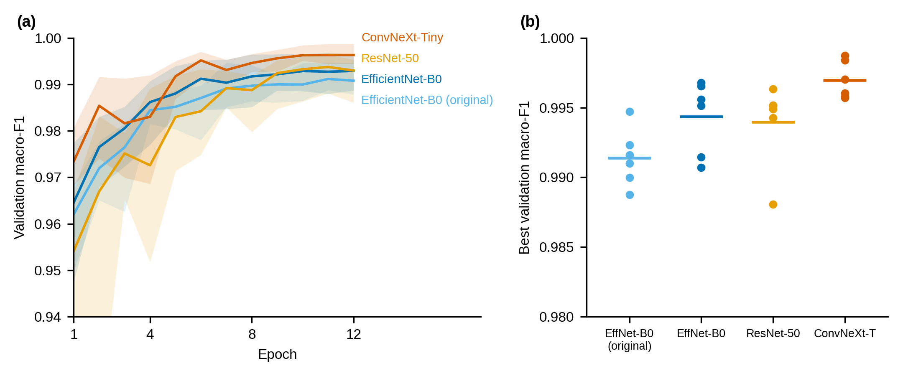

# Brain MRI Tumor Classification with Active Learning

Four-class classification of brain MRI slices (glioma, meningioma, pituitary tumor, no tumor) with a convolutional network, an active learning loop, and a small desktop application where a user confirms predictions that are later used to retrain the model.

This repository continues a group project from the Human-Centric Artificial Intelligence course (University of Coimbra, 2025). The original code is kept apart in [`original/`](original/) and credited [below](#credits). Everything outside that folder is new work by Daniel Rocha, aimed at a sounder evaluation and a reproducible codebase.

> **Status (2026-11-17):** repository being set up. The original code has not been moved here yet and none of the experiments have been re-run, so there are no results in this repository yet. The roadmap below lists what is planned.

> **Not a clinical tool.** This is a learning and portfolio project. It must not be used to diagnose, triage or make any medical decision.

## Contents

[Original work and what is new](#original-work-and-what-is-new) · [Repository structure](#repository-structure) · [Environment](#environment) · [Data](#data) · [Roadmap](#roadmap) · [Results](#results) · [Reproducibility](#reproducibility) · [License](#license) · [Credits](#credits)

## Original work and what is new

The original project (group work, 2025) did the following:

- A 4-class classifier: EfficientNet-B0 pretrained on ImageNet with a new classification head, 224x224 inputs.
- A simulated active learning loop: a fixed test set of 4,404 images is set aside, the training split (17,613 images) starts with 1% labelled and the rest is treated as unlabelled. Each iteration selects the 20 images with the highest prediction entropy and fine-tunes for 3 epochs. The saved final state has 596 labelled images and 17,017 still in the pool.
- A desktop application (customtkinter) with user accounts, predictions with a confidence value, a history, and a confirmation step. After 20 confirmed cases the model is retrained.

## Audit of the original evaluation

A first audit of the original project (2026-11-17, details and method in [`docs/evaluation_audit.md`](docs/evaluation_audit.md)) found that its reported accuracy cannot be taken at face value:

- About a quarter of the test images have a training image with an identical perceptual hash, and about half are within a Hamming distance of 2. There are no byte-identical copies, but the images are near-duplicates.
- The best checkpoint and the early stopping were chosen on the test set.
- The labelled-set table (`treino_rotulado.csv`) and the retraining script read saved indices against the wrong list: 129 of the 596 labelled images are test images.

What this repository changes is listed in the [roadmap](#roadmap) and tracked in [`docs/decisions.md`](docs/decisions.md). The original code stays untouched in `original/`, so the differences can always be compared.

## Repository structure

```
mri-tumor-classification-active-learning/
├── README.md
├── environment.yml    # conda environment (draft, not tested yet)
├── .gitignore
├── configs/           # seeds and parameters (config.yaml)
├── data/              # NOT tracked by Git (see data/README.md)
├── docs/              # decision log and evaluation notes
├── original/          # group code as submitted, without data, weights or database (planned)
├── scripts/           # numbered, flat scripts that run the pipeline step by step (planned)
├── src/               # reusable code: splits, metrics, models, active learning (planned)
├── app/               # desktop application (planned)
├── results/           # light tables and figures (planned)
└── tests/             # checks for splits and metrics (planned)
```

Folders marked as planned are created when they get their first file.

## Environment

```bash
conda env create -f environment.yml
conda activate mri-tumor-classification-active-learning
```

The environment file is a draft and has not been tested yet. Exact versions will be pinned once the pipeline runs.

## Data

The images are **not** stored in this repository. The original project used the Kaggle dataset [Brain Tumour Classification](https://www.kaggle.com/datasets/rishiksaisanthosh/brain-tumour-classification). Its Kaggle page lists the license as "Unknown", so the images are not redistributed here. Source, version, checks and the expected local layout are in [`data/README.md`](data/README.md).

## Roadmap

Draft, in order of priority:

- [ ] Re-run the original pipeline and record the baseline metrics
- [x] Check the dataset for near-duplicate images before splitting (group-aware splits in `splits/`)
- [x] Use separate training, validation and test sets; choose checkpoints on validation only (supervised baselines)
- [x] Report per-class recall and precision, the confusion matrix, and confidence intervals, not only accuracy (supervised models, internal test)
- [ ] Compare active learning with random sampling and with a fully supervised baseline
- [ ] Make the retraining loop unable to reach the test set
- [ ] Application: hash passwords, keep the database out of the repository, move settings to the config file
- [ ] Data download script, pinned environment, basic tests

## Results

**Supervised baselines (validation, 6-fold group-aware cross-validation).** Mean of the best-epoch validation macro-F1 per fold; details and caveats in [`docs/baselines.md`](docs/baselines.md).

| Model | Mean | SD |
|:--|:--|:--|
| ConvNeXt-Tiny | 0.9970 | 0.0013 |
| EfficientNet-B0 | 0.9944 | 0.0026 |
| ResNet-50 | 0.9940 | 0.0030 |
| EfficientNet-B0 (head of the original project) | 0.9914 | 0.0020 |
| DINOv2-B, frozen, linear layer only (not in the figure) | 0.9192 | 0.0081 |



The differences are small and the folds share training data, so no significance test is reported. For reference, the original project reported a best test accuracy of 0.9475, where the best checkpoint was chosen on the test set itself, so that figure is likely optimistic.

**Closed test set (2,989 images, group-aware split, opened once per final model).** Three seeds per model; macro-F1 mean (SD); details, intervals and limits in [`docs/test_evaluation.md`](docs/test_evaluation.md).

| Model | Test macro-F1 | Test accuracy per seed |
|:--|:--|:--|
| ConvNeXt-Tiny | 0.9965 (0.0042) | 0.9987, 0.9990, 0.9916 |
| EfficientNet-B0 (original head) | 0.9927 (0.0009) | 0.9936, 0.9920, 0.9923 |

ConvNeXt-Tiny is better in two seeds and equal in one, so the ranking is not firm. This is still an internal test on the same dataset; the external test is pending.

## Reproducibility

- **Seeds:** fixed through the value in `configs/config.yaml`.
- **Versions:** `environment.yml`; exact versions to be added.
- **Data:** source and checks in `data/README.md`.
- **Decisions:** logged in `docs/decisions.md`.
- **Note:** small differences between machines (CPU/GPU, library versions) can remain because of non-deterministic training operations.

## License

The code will be released under the MIT license; the `LICENSE` file is still to be added. The dataset is not covered by it and keeps its own terms.

## Credits

Original group project, Human-Centric Artificial Intelligence, University of Coimbra, 2025: João Pedro Ferreira, João Frederico Lopes and Daniel Rocha. 

Maintained by Daniel Rocha.
