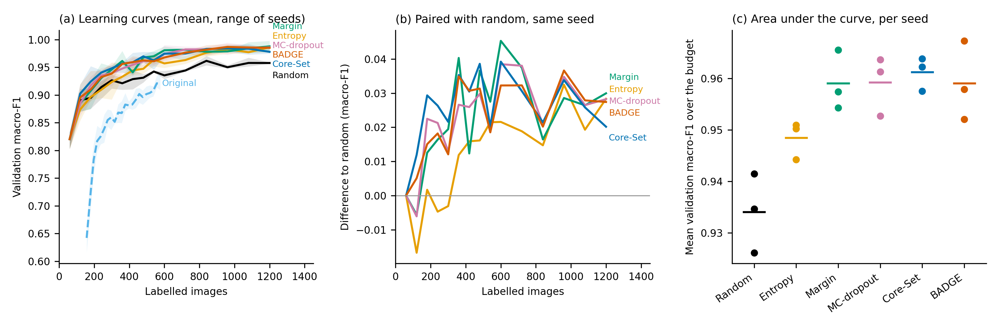

# Active learning results

Results of the plan frozen in [`active_learning_design.md`](active_learning_design.md): six query strategies and a random baseline with the same ConvNeXt-Tiny, a replica of the original loop, and a full-pool reference, three seeds each (42, 43, 44), run on Kaggle with `scripts/13_active_learning.py`. Analysis: `scripts/14_active_learning_analysis.py`. Predictions and per-round metrics: `results/active_learning/`. The design was not changed after the test and external probabilities were saved.

## Setup in one paragraph

The pool holds 15,717 images (folds 1 to 5, group-aware). Each run starts from 60 random labelled images and adds 60 per round up to 600, then 120 per round up to 1,200 (15 budget points). Every round retrains ConvNeXt-Tiny from the ImageNet weights (400 steps) and keeps the checkpoint with the best macro-F1 on a 400-image validation subset drawn from fold 0. The initial set and the validation subset depend only on the seed, so a strategy and random sampling can be compared seed by seed. Test (2,989 images) and external (2,180 images) predictions were saved at 60, 300, 600 and 1,200 labelled images and not looked at before all runs finished.

(a) Validation macro-F1 against labelled images, mean of three seeds with the range as a band. The dashed curve is the original-protocol arm, which uses a different model (EfficientNet-B0 with the original head) and 157 to 577 images. (b) Difference to random sampling with the same seed. (c) Area under the validation curve per seed, in practice the mean macro-F1 over the whole budget.

## Test and external macro-F1

Mean over three seeds with the standard deviation in parentheses. In square brackets: in how many of the three seeds the strategy beat random sampling with the same seed. At 60 images all arms share the same initial set, so the values are identical by construction.

**Internal test (2,989 images)**

| Strategy | 60 | 300 | 600 | 1,200 |
|:--|--:|--:|--:|--:|
| Random | 0.826 (0.008) | 0.925 (0.003) | 0.942 (0.003) | 0.960 (0.004) |
| Entropy | 0.826 (0.008) | 0.925 (0.030) [2/3] | 0.964 (0.003) [3/3] | 0.988 (0.002) [3/3] |
| Margin | 0.826 (0.008) | 0.946 (0.003) [3/3] | 0.975 (0.006) [3/3] | 0.991 (0.001) [3/3] |
| MC-dropout | 0.826 (0.008) | 0.940 (0.016) [2/3] | 0.971 (0.009) [3/3] | 0.988 (0.004) [3/3] |
| Core-Set | 0.826 (0.008) | 0.948 (0.005) [3/3] | 0.970 (0.006) [3/3] | 0.980 (0.008) [3/3] |
| BADGE | 0.826 (0.008) | 0.950 (0.004) [3/3] | 0.976 (0.007) [3/3] | 0.991 (0.002) [3/3] |

**External set (2,180 images)**

| Strategy | 60 | 300 | 600 | 1,200 |
|:--|--:|--:|--:|--:|
| Random | 0.684 (0.004) | 0.824 (0.021) | 0.841 (0.015) | 0.866 (0.015) |
| Entropy | 0.684 (0.004) | 0.835 (0.051) [2/3] | 0.901 (0.011) [3/3] | 0.940 (0.003) [3/3] |
| Margin | 0.684 (0.004) | 0.866 (0.020) [2/3] | 0.914 (0.011) [3/3] | 0.941 (0.002) [3/3] |
| MC-dropout | 0.684 (0.004) | 0.875 (0.008) [3/3] | 0.904 (0.024) [3/3] | 0.945 (0.008) [3/3] |
| Core-Set | 0.684 (0.004) | 0.863 (0.005) [3/3] | 0.906 (0.019) [3/3] | 0.915 (0.016) [3/3] |
| BADGE | 0.684 (0.004) | 0.863 (0.013) [3/3] | 0.912 (0.019) [3/3] | 0.945 (0.006) [3/3] |

The table is also in `figures/al_summary.csv`, with the per-class recall at each budget.

## References

| Run | Labelled images | Test macro-F1 | External macro-F1 |
|:--|--:|--:|--:|
| Full pool, same ConvNeXt-Tiny, 6 epochs | 15,717 | 0.992 | 0.943 |
| Supervised ConvNeXt-Tiny from the earlier evaluation, longer training | 15,717 | 0.9965 | 0.9495 |
| Original protocol, EfficientNet-B0 with the original head, entropy, 21 rounds of 20 | 577 | 0.937 | 0.843 |
| Random sampling, ConvNeXt-Tiny | 600 | 0.942 | 0.841 |

## What the results show

- **Every strategy beat random sampling from 600 images on, in all three seeds, on both sets.** At 1,200 images the gain in test macro-F1 ranges from 0.020 (Core-Set) to 0.031 (BADGE), and on the external set from 0.049 (Core-Set) to 0.079 (MC-dropout and BADGE). The external gain is larger than the internal one.
- **At 1,200 labelled images (7.6% of the pool) the best strategies are close to the full-pool reference:** test 0.988 to 0.991 against 0.992, external 0.940 to 0.945 against 0.943. They stay about 0.005 below the longer supervised baseline on both sets. The full-pool reference here uses the same short recipe as the active runs (6 epochs, no tuning), so it is a reference for this setup and not the best possible supervised result.
- **Margin, BADGE, MC-dropout and entropy are not separated.** At 1,200 images their external macro-F1 differs by less than the seed spread (standard deviations of 0.003 to 0.008, only three seeds). No significance test is reported; with three seeds it would say little. Core-Set is the exception: it is the lowest of the six at 1,200 images on both sets (test 0.980, external 0.915), although it has the highest area under the validation curve (0.961 against 0.959 for margin, MC-dropout and BADGE). The validation subset has only 400 images, so these small differences on it should not be over-read.
- **Early rounds are noisy.** At 300 images entropy and MC-dropout are better than random in only two of three seeds, and entropy has a standard deviation of 0.051 on the external set, which comes from one seed.
- **The glioma problem is not solved by choosing images.** External glioma recall at 1,200 images is 0.84 to 0.86 for all strategies (random: 0.78), the same level as the fully supervised ConvNeXt-Tiny (0.859). Active learning improves the other classes and the overall score, but the gliomas missed on the external set stay missed. See [`external_evaluation.md`](external_evaluation.md).
- **The strategies label a different mix of classes.** At 1,200 images random sampling holds about 270, 290, 310 and 330 images of glioma, meningioma, no tumour and pituitary (a mean over seeds, rounded), while the uncertainty strategies hold about 270 to 320 gliomas and 420 to 480 meningiomas, with fewer no-tumour images (about 190 to 210). Meningioma is the class they ask for most. This is descriptive; whether the class mix explains the gain was not tested.
- **The original loop is no better than random sampling at its size.** With 577 labelled images it reaches 0.937 (test) and 0.843 (external), about the same as random sampling at 600 images with ConvNeXt-Tiny (0.942 and 0.841), and clearly below the uncertainty strategies at 600 (0.964 to 0.976 and 0.90 to 0.91). The two setups differ in model, in the continued fine-tuning and in the class-balanced start, so this does not isolate the strategy, but it does show that the accuracy reported in the original project (0.9475 with 596 images) cannot be read as a result of the query strategy.

## Cost

Training takes about 84 s per round for every strategy. Selection adds about 22 s per round for entropy and margin, and about 44 s for MC-dropout, Core-Set and BADGE. A full run of one strategy and one seed took 22 to 32 minutes on one T4; random sampling the shortest. The cost matters only in this simulation. A real annotation round would be dominated by the annotators' time.

## Limits

- Three seeds per arm. Differences between the better strategies are within the spread; claims are limited to "better than random" and "Core-Set weaker at 1,200".
- The simulation uses labels that already exist. It does not model annotation effort, annotator error or class imbalance in a real unlabelled pool.
- Checkpoints are chosen on a 400-image validation subset, which is noisy and could favour some strategies at specific budgets.
- Test and external probabilities exist only at four budgets (60, 300, 600, 1,200), so the shape of the test curve between them is unknown. The original-protocol arm has its own budget (577 images), reported at its last round.
- The external set is only partly independent of the training sources (see [`limitations.md`](limitations.md)).
- One model family and one recipe. The ranking of strategies could change with another backbone or training length.
- This is not a clinical result.
