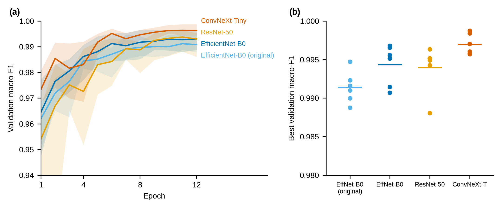

# Supervised baselines

Date: 2026-11-18. Script: `scripts/07_train_supervised.py`; figure: `scripts/08_plot_baselines.py`.

## Setup

- 6-fold StratifiedGroupKFold on the train/validation part (one further fold held out as test, seed 42); near-duplicate groups never cross folds.
- AdamW, lr 3e-4, weight decay 1e-4, cosine schedule, 12 epochs, batch 64, mixed precision, augmentation on GPU.
- The epoch with the best validation macro-F1 is kept. The test set is not touched.

## Results

| Model | Folds | Mean best val macro-F1 | SD |
|:--|:--|:--|:--|
| ConvNeXt-Tiny | 6 | 0.9970 | 0.0013 |
| EfficientNet-B0 | 6 | 0.9944 | 0.0026 |
| ResNet-50 | 6 | 0.9940 | 0.0030 |
| EfficientNet-B0, head of the original project | 6 | 0.9914 | 0.0020 |
| DINOv2-B, frozen backbone + linear layer (not in the figure) | 6 | 0.9192 | 0.0081 |

## Reading

- ConvNeXt-Tiny is the best supervised baseline, with the best score in every fold, but the margin over EfficientNet-B0 and ResNet-50 is about one standard deviation.
- The head of the original project (frozen first 100 parameters, dense layer with batch normalisation) is the weakest of the four.
- The folds share training data, so they are not independent and no formal test is applied.
- The best epoch is chosen on the same fold that is reported, so these scores are slightly optimistic. The test set will be used once per final model.

## Notes

- Fold 3 has 15,681 training images, which leaves a final batch of one image. Batch normalisation in the original head cannot train on one sample, so batches with fewer than two images are now skipped (commit 51d2c39).
- Folds 3 to 5 of the later runs were trained on a free Kaggle GPU after the Colab quota ran out; the code and data are the same.
- The DINOv2-B linear probe (frozen ViT-B/14, only the final linear layer trained, same recipe and folds) was trained on a Kaggle T4. It is far below the fine-tuned models and is left out of the figure so the axes stay readable. Its curve was still rising slowly at epoch 12 (same learning rate and 12 epochs as the others), so the value is slightly underestimated; it shows that the frozen features alone are not enough for this task.
- Test-set evaluation with 3 seeds: see `docs/test_evaluation.md`.
